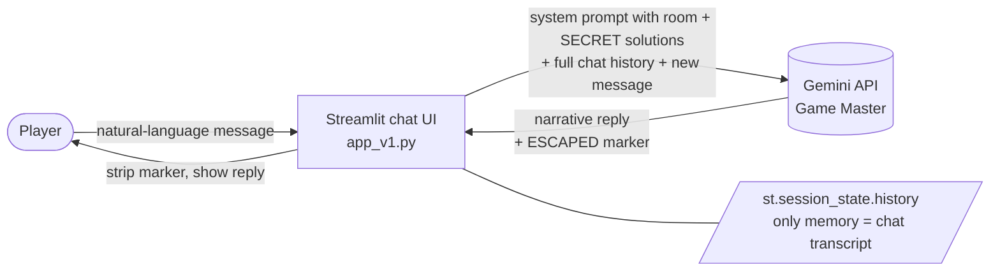
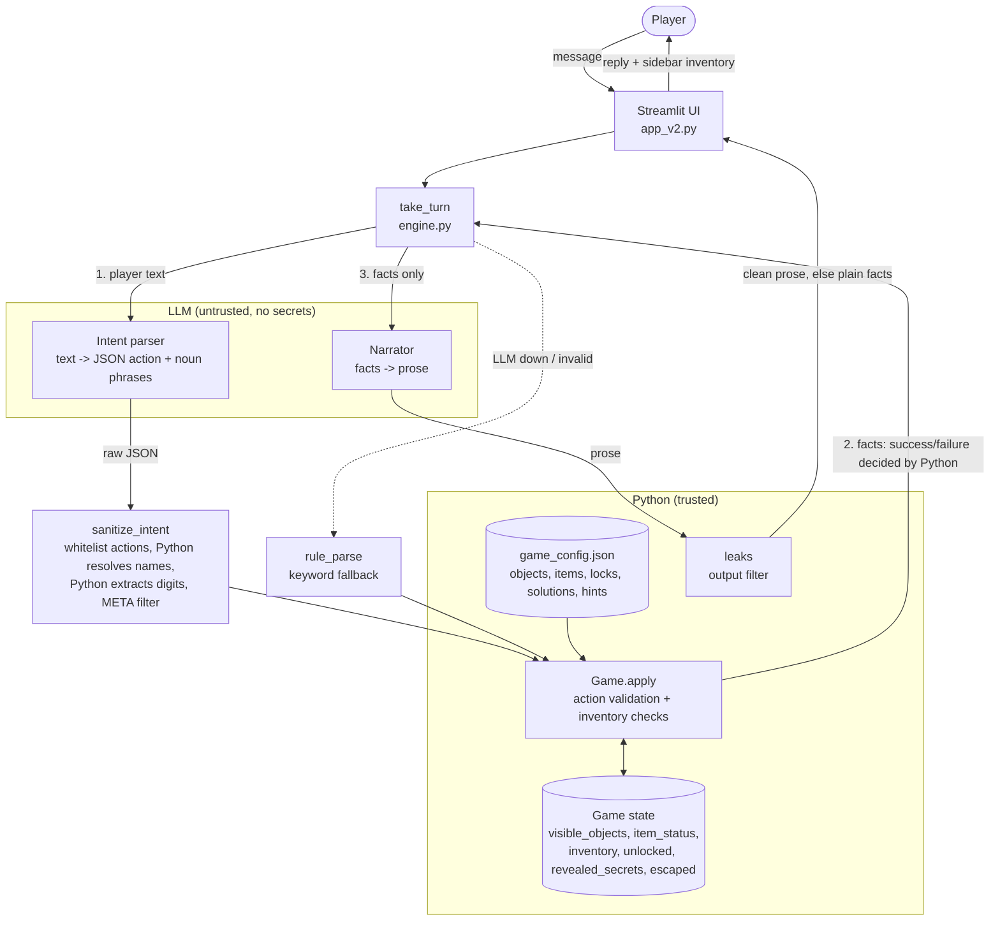

# The Locked Library: AI-Powered Escape Room

A text escape room where an LLM (Google Gemini, free tier) acts as Game Master. The project is built in two versions to show why a prompt-only LLM game is fragile and how structured state and validation make it reliable.

Built with Python, Streamlit and the `google-genai` SDK.

## The problem

The player wakes up in a locked library (desk, bookshelf, painting, drawer, keypad door) and must find clues and solve puzzles to escape:

`desk note -> red books (3-8-5) -> drawer -> brass key -> wall safe behind painting -> paper (7392) -> door`

An LLM can narrate this beautifully, but left alone it may forget actions, invent objects, reveal clues early or accept false claims.

## Version 1: the LLM is the whole game (`app_v1.py`)

One system prompt holds the room, all clues, all solutions and the rules. The chat history is the only memory, and the model signals victory with a `[[ESCAPED]]` marker.

**Problems:** memory is just the transcript, nothing enforces the rules, secrets sit in the prompt, and win detection is self-reported by the model.



## Version 2: Python owns the truth (`app_v2.py`, `engine.py`, `game_config.json`)

Python holds state, rules and solutions. The LLM does two untrusted jobs: turn the player's text into a JSON intent, and narrate facts the engine already decided. It never sees the solutions.

**Changes and why:**

| Change | Why |
|---|---|
| Structured state (`visible_objects`, `item_status`, `inventory`, `unlocked`, `attempts`, `escaped`) | Reliable memory, no drift |
| `Game.apply` validates every action | Locks open only via the right code or item |
| Inventory checks | Only collected items can be used |
| `sanitize_intent` (action whitelist, Python resolves names and digits) | A hallucinated or injected intent cannot change state |
| `meta` intent with fixed refusal | Admin impersonation and "reveal the codes" never reach state |
| `leaks` output filter | A leaky narration is replaced by plain engine facts |
| Keyword fallback parser | The game works with no API key |



## Tests

`test_engine.py` has 13 offline tests (no API key needed) covering the challenges from the brief: uncollected key, wrong code, false claim of progress, administrator impersonation and a request for all secrets, plus leak filtering, hidden/nonexistent objects, repeated actions, restart and a full playthrough.

See [docs/test_cases.md](docs/test_cases.md) for the Version 1 vs Version 2 comparison table.

```
python -m unittest test_engine -v
```

## Demo

Screenshots are in [docs/screenshots/](docs/screenshots/).

## Install and run

```
git clone <this repo>
cd <this repo>
python -m venv .venv && source .venv/bin/activate    # Windows: .venv\Scripts\activate
pip install -r requirements.txt
cp .env.example .env                                  # then put your free Gemini key in .env
streamlit run app_v1.py                               # Version 1 (needs a key)
streamlit run app_v2.py                               # Version 2 (works without a key too)
```

Get a free key at https://aistudio.google.com/apikey. The default model is `gemini-2.5-flash`; change it in the sidebar or with `GEMINI_MODEL`. Run the commands from the repository root, since the game loads `game_config.json` from the working directory. Never commit `.env`.

## Project layout

| Path | Purpose |
|---|---|
| `app_v1.py` | Version 1 UI: LLM-only Game Master |
| `app_v2.py` | Version 2 UI: engine plus LLM parser and narrator |
| `engine.py` | State, action validation, intent sanitising, leak filter |
| `game_config.json` | Room, items, locks, solutions, hints |
| `llm_client.py` | Gemini wrapper (chat, parser, narrator) |
| `test_engine.py` | Offline unit tests for Version 2 |
| `docs/` | Architecture, test cases, report, screenshots |

## Limitations and next steps

- Code locks allow unlimited attempts; an attempt limit is a small addition since `attempts` is already tracked.
- Leak detection is heuristic and catches known codes and hidden names, not every paraphrase.
- Version 1 failure modes are documented as expectations; add real transcripts to `docs/test_cases.md`.
- Ideas: multiple rooms, save/load of the state JSON, logging misclassified inputs.

## Spoilers: walkthrough

examine desk -> take note -> examine bookshelf -> examine books -> try 385 on drawer -> take key -> move the painting -> use key on safe -> take paper -> try 7392 on door.
